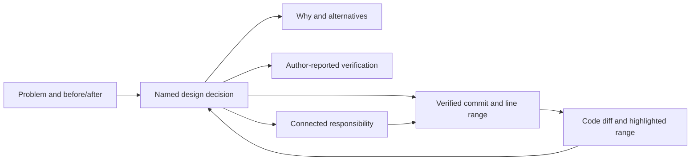

# Understanding a change through its design and code

The first commit-review UI placed a diff beside an explanation. It left the reader responsible for finding which design claim referred to which implementation. The new guide connects the user's problem, design decisions, relationships between responsibilities, immutable code locations, and verification evidence.

## Evidence and limits

[Gonçalves et al., 2025](https://arxiv.org/abs/2503.21455) observed ten experienced reviewers across 25 reviews. They describe reviewers building context before inspecting code, testing, and discussing it, while comparing expected behavior with the implementation. This supports an initial problem and before/after example followed by navigable implementation evidence. It does not establish that our UI will improve comprehension.

[Tao et al., 2012](https://www.microsoft.com/en-us/research/publication/how-do-software-engineers-understand-code-changes-an-exploratory-study-in-industry/) identify information needs around completeness, consistency, and effects on other components. This motivates explicit relationships and visible coverage rather than a file list with a generic explanation.

[Di Biase et al., 2019](https://pmc.ncbi.nlm.nih.gov/articles/PMC7924728/) studied change decomposition in a controlled experiment. Participants saw organizational benefits, but the study did not establish improvements in review time or rationale understanding. Merely splitting changes into commits is therefore insufficient evidence for the earlier design. We use commits as stable boundaries, then connect decisions to code and evidence within each boundary.

## Reader's path

The guide starts with the concrete problem and a before/after behavior example. Its diagram contains named responsibilities and their declared relationships. Selecting a node shows why the decision was made, what changed, its code locations, and the author's verification results. Each code link opens the correct file and scrolls to the mapped lines in the selected commit or its first parent. Those ranges are highlighted. Selecting mapped code updates the corresponding explanation, so exploration can start from either the design or implementation.

Readers can follow the diagram's connections to another responsibility, use the step selector, or explore files freely. Explicitly excluded files display their reason. The full Markdown design remains available as a separate tab for additional context and diagrams; it is not the primary navigation mechanism.

The default layout places the guide below the diff when the editor is narrower than 1,200 logical pixels, preserving the full width for code. Wider editors show the guide beside the diff. Readers can explicitly choose either layout and resize the divider; changing the arrangement retains the selected commit, design step, and code viewer.

## Correspondence contract

Explorer writes `<full-sha>.review.json` beside each commit's Markdown explanation. It identifies the exact commit, explains problem/before/after, and provides ordered steps with IDs, rationale, implementation summary, verification, source anchors, and labeled links to other steps. Step titles must also appear in the Markdown document. A source anchor uses an actual changed path, `before` or `after`, and a 1-based inclusive line range in that immutable revision. Deletions use the before side. Every changed file is anchored or explicitly excluded with a reason.

Both the host acceptance check and IDE validate the hash, structure, relationship targets, file coverage, and source line ranges. Workspace line numbers, stale hashes, unknown paths, and nonexistent lines are rejected. The diagram displays declared relationships without inferring connections from filenames. These checks verify the existence of code locations, not the semantic truth of the explanation, graph edges, or test claims. Verification is labeled as author-reported; missing evidence must be stated as unverified.

Missing or invalid maps display a correspondence-unavailable message while the actual commit diff and full design remain accessible. Completed sessions with committed code can generate the new maps when resumed, without changing source or rewriting commits. This documentation repair is attempted once per resumed session and respects the existing token budget.

## Evaluating the feature

Server tests cover invalid correspondence, file coverage, and diagram target validity. Kotlin tests added during this change were removed to avoid introducing a test dependency and presentation-test maintenance costs. IDE layout, navigation, and committed-code display require manual verification. A human evaluation remains necessary. Useful tasks are to explain the before/after behavior, trace a handoff between two components, identify a design tradeoff and its exact code, identify verification evidence, and locate an excluded or unexplained file. Compare answer correctness, time, and navigation effort with the previous split-pane UI. Do not treat a successful build or a reader's confidence as proof of improved comprehension.
